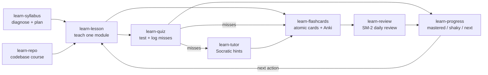

# learn-anything-skill

**Turn any topic, doc, or codebase into a personal course, with a tutor that won't just hand you the answer.**


You ask an AI to explain something, it gives you a clear, confident answer, you nod
along, and a week later it is gone. The explanation was fine. The problem is that
reading an answer feels like learning while doing very little of it. What actually
makes knowledge stick is well known: pulling it out of memory (retrieval practice),
spacing those pulls out over days, mixing problem types, studying worked examples
before solving on your own, and being questioned rather than told.

This pack turns Claude Code into a study partner built on those ideas. It checks what
you already know before planning anything, teaches one module at a time with pauses
where you have to produce the answer, quizzes you with distractors built from real
misconceptions, schedules flashcard reviews with the SM-2 algorithm, and tutors you
through problems with hints that get stronger step by step. It only gives the full
answer when you have asked three times or say you give up.

Everything lives in plain files in a `learn/<topic>/` folder in your project:
syllabus, lessons, quiz log, mistakes, cards, deck. You can read them, edit them, put
them in git, and import the cards into Anki. Progress reports come from that evidence,
not from how confident you feel.

## What's inside

### Skills

| Skill | What it does |
|---|---|
| [`learn-syllabus`](skills/learn-syllabus/SKILL.md) | Asks 3-5 diagnostic questions, places your level, then writes `syllabus.md`: modules, verb-based objectives, prerequisites, time estimates and a capstone project. |
| [`learn-lesson`](skills/learn-lesson/SKILL.md) | Teaches one module: hook, short explanation, worked example, a faded example you finish, then 3 retrieval questions. Depth follows your level. |
| [`learn-quiz`](skills/learn-quiz/SKILL.md) | Writes and grades quizzes (multiple choice with plausible distractors, short answer, explain-it-back), logs results and every miss to `mistakes.md`. |
| [`learn-flashcards`](skills/learn-flashcards/SKILL.md) | Writes atomic cards (one fact each, cloze where useful) and exports Anki-importable TSV with `anki_export.py`, which deduplicates and checks card length. |
| [`learn-review`](skills/learn-review/SKILL.md) | Runs a spaced-repetition session; `srs.py` implements SM-2 (ease, interval, repetitions, due date) over a JSON deck with `due`, `grade`, `stats`. |
| [`learn-repo`](skills/learn-repo/SKILL.md) | Turns a codebase into a course: reading order, guided tours of key files with real line references, and exercises ("trace this request", "add a small feature") with hints. |
| [`learn-tutor`](skills/learn-tutor/SKILL.md) | Socratic tutoring: guiding questions, hints in escalating levels, the answer only after three requests or when you give up, then a near-identical problem to prove it stuck. |
| [`learn-progress`](skills/learn-progress/SKILL.md) | Progress report per module (mastered / shaky / in progress / not started) from quiz logs, card reviews and open mistakes, with `progress.py`, plus what to do next. |

### Agents

| Agent | What it does |
|---|---|
| [`socratic-tutor`](agents/socratic-tutor.md) | Diagnoses where a learner's reasoning breaks and returns the next guiding question plus a three-level hint ladder, without leaking the answer. |
| [`quiz-master`](agents/quiz-master.md) | Writes and grades quizzes, tough but fair: misconception-based distractors, an answer key written first, grading by meaning, log lines ready to append. |
| [`explainer`](agents/explainer.md) | Explains anything at five levels (child, teen, undergrad, practitioner, expert), each true at its depth, then asks which level you want next. |

## Install

In Claude Code:

```
/plugin marketplace add vivekbhange-hub/learn-anything-skill
/plugin install learn-anything-skill@learn-anything-skill
```

Manual install: copy the folders in `skills/` into `~/.claude/skills/` and the files
in `agents/` into `~/.claude/agents/`. The helper scripts need Python 3.9+ and nothing
else (standard library only, no network).

## Try it in 60 seconds

Open Claude Code in any project folder and say:

```
I want to learn Python decorators. I know basic Python. About 3 hours a week.
```

`learn-syllabus` asks its first diagnostic question and waits:

> *Example output (illustrative, yours will differ):*
>
> Before I plan anything, a few quick questions so the course fits you. Say "skip" if
> you have no idea; that is useful information too.
>
> **Q1.** In Python, can you pass a function as an argument to another function
> without calling it? Show a one-line example.

After 3-5 answers it writes `learn/python-decorators/syllabus.md`:

```markdown
# Syllabus: Python decorators

Goal: write and debug your own decorators, including ones that take arguments
Level: beginner (diagnosed 2026-11-07)
Time: 4.5 hours over 2 weeks at 3h/week

## M1. Functions are objects
- Objectives:
  - Pass a function as an argument and return one from another function
  - Predict what a name refers to after reassignment
- Prerequisites: none
- Time: 40 min
- Mastery check: write a function that returns a configured function
...
## Capstone: a @retry decorator with backoff
```

Then keep going with plain requests: "teach me M1", "quiz me", "make flashcards",
"review my cards", "I'm stuck on this exercise", "how am I doing?".

The helper scripts also work on their own:

```bash
python3 skills/learn-flashcards/anki_export.py learn/python-decorators/cards.md --json-out learn/python-decorators/cards.json
python3 skills/learn-review/srs.py learn/python-decorators/deck.json add learn/python-decorators/cards.json --today 2026-11-07
python3 skills/learn-review/srs.py learn/python-decorators/deck.json due --today 2026-11-07
python3 skills/learn-review/srs.py learn/python-decorators/deck.json grade c3f1 4 --today 2026-11-07
python3 skills/learn-progress/progress.py learn/python-decorators --today 2026-11-07
```

## How it works



Each skill reads and writes files in `learn/<topic-slug>/`, so they work together
without any shared state beyond the folder:

```
learn/python-decorators/
  syllabus.md        modules as "## M1. Title" headings      learn-syllabus / learn-repo
  learner.md         level, goal, diagnostic answers          learn-syllabus
  lessons/m1-*.md    your notes from each lesson               learn-lesson
  tours/, exercises.md   codebase tours and exercises          learn-repo
  quizzes/*.md       each quiz with its answer key             learn-quiz
  quiz-log.jsonl     one line per graded question              learn-quiz, learn-lesson, learn-tutor
  mistakes.md        "- [ ]" open / "- [x]" fixed              learn-quiz, learn-tutor
  cards.md           your flashcards (Q:/A:, C: for cloze)     learn-flashcards
  anki-*.tsv         Anki import files                         anki_export.py
  deck.json          spaced-repetition schedule                srs.py
  progress.md        latest progress report                    progress.py
```

The learning science, briefly, and where each idea shows up:

- **Retrieval practice:** every lesson ends with three recall questions; quizzes and
  reviews ask before they show.
- **Spaced repetition:** `srs.py` runs SM-2, so cards come back after 1 day, 6 days,
  then at growing intervals scaled by how hard each card is for you.
- **Interleaving:** mixed quizzes alternate modules instead of grouping them.
- **Worked examples, then fading:** lessons show a full solution, then a parallel
  problem with the last steps removed for you to complete.
- **Socratic questioning:** the tutor asks one question at a time aimed at the first
  step where your reasoning breaks, with hints that escalate from a nudge to a
  partial step.

## Principles and limits

- **It will make you work.** Lessons pause for your answers, and the tutor holds the
  answer back until you have asked three times or give up. If you only want a quick
  explanation, ask for one directly, or use the `explainer` agent.
- **Evidence over feelings.** A module is "mastered" only with 5+ quiz attempts at
  85%+, good card retention and no open mistakes. You can read the rules in
  `progress.py` and change them.
- **Claude can be wrong.** Explanations and answer keys come from a language model.
  When you give it a source (a document, a codebase), it teaches from that source and
  cites it; for high-stakes material (exams, medicine, law), check against the
  primary source.
- **Local and private.** Nothing leaves your machine beyond your normal Claude Code
  session. The scripts make no network calls. It never imports into your Anki profile
  or commits to your repo; it writes files and tells you what to do with them.
- **Not a replacement for doing.** For skills (coding, writing, an instrument), the
  exercises and capstone matter more than any card.
- SM-2 is a well-understood, simple scheduler. It is not the newest algorithm (Anki's
  FSRS can schedule better with lots of review history); the deck is plain JSON if you
  want to swap it.

## Contributing

See [CONTRIBUTING.md](CONTRIBUTING.md). Run the tests with
`python -m unittest discover -s tests -v`.

## License

[MIT](LICENSE) © 2026 Vivek Bhange
